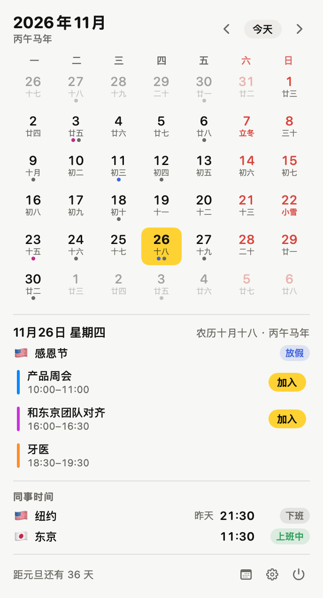
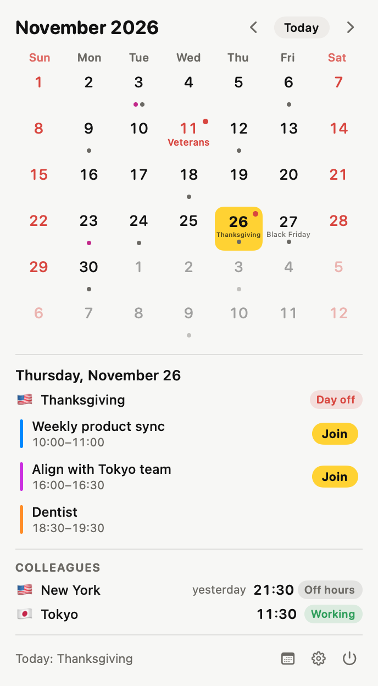

# Second Calendar

A free, open-source menu bar calendar for macOS that knows three countries' holidays and your
colleagues' working hours.

**Download:** [enzomac.app/secondcalendar](https://enzomac.app/secondcalendar/?ref=github-readme) (signed and notarized DMG, macOS 14 or later, updates itself)

**No Mac?** Try the [web version](https://enzomac.app/secondcalendar/calendar/?ref=github-readme) in any browser: the same month view, holidays and colleague clocks.

[中文说明](#中文) · [日本語](#日本語)

<p align="center">
</p>

## What it does

- **Menu bar text you choose:** date, weekday, lunar date, time, e.g. `Nov 24 Tue` or `11月24日 周二 十月初五`.
- **One main calendar, three countries.** Switch the app language and the main calendar follows:
  - 中文 → China: lunar dates, solar terms, traditional festivals, public holidays (休) and make-up workdays (班).
  - English → United States: federal holidays with weekend shifts, plus common observances.
  - 日本語 → Japan: national holidays (祝) including substitute holidays.
- **Colleagues' holidays as colored dots.** The two other countries show up as small dots under the date; click a day to see which holiday it is.
- **Colleague clocks.** The local time in the cities you add, whether people there are at work (9–18 by default), and their weekends and public holidays.
- **Your events.** Reads the macOS Calendar database (iCloud, Google, Exchange: any account added in System Settings), shows a day's events, finds Zoom / Meet / Teams / Webex / Tencent Meeting / Feishu links with a Join button, and adds events quickly.
- **Countdown** to the next holiday, and an optional reminder at 8 pm the evening before a make-up workday or the first day off.
- Holiday data updates itself every few days; you can also update it in Settings.

## Privacy

- Your events never leave your Mac. The app reads them through EventKit only to show them.
- Network use: holiday data files (jsDelivr / GitHub and cao.go.jp), the update feed (Sparkle, no system profile), and **anonymous usage statistics**.
- Usage statistics: at most once a day the app tells Enzomac's own analytics server (Umami) that it was opened, with the app and macOS version, the app language, the main calendar's country, whether calendar access is on, a rough number of colleague cities ("1-2", "3-5") and a random install id. Never your events, calendar names, cities or anything you type. Turn it off in **Settings → General → Share anonymous usage statistics**. The code is in [`Telemetry.swift`](Sources/SecondCalendarApp/Telemetry.swift).
- Full policy: [enzomac.app/privacy](https://enzomac.app/privacy/).

## Build from source

Needs Xcode 16 or later (Swift 6 toolchain) and macOS 14.

```bash
swift test                      # unit tests (holiday rules, lunar dates, colleague status)
swift run SecondCalendarApp     # run without bundling (no calendar permission prompt, no updates)
Scripts/make-app.sh             # build "build/Second Calendar.app" (ad-hoc signed)
Scripts/snapshot.sh 2026-10-01  # render the popover in three languages to docs/ui/ with sample events
Scripts/update-holidays.sh      # refresh the bundled holiday data
Scripts/web-data.sh             # export holidays and lunar labels for the web calendar (enzomac.app/secondcalendar/calendar/)
```

`Scripts/release.sh` is what the official builds use (Developer ID signing, notarization, Sparkle appcast);
it needs Enzomac's certificate and update key, so builds you make yourself won't update through the official feed.

Layout: `Sources/CalendarCore` is the UI-free part (dates, holidays, lunar labels, colleague clocks, meeting
links) with tests; `Sources/SecondCalendarApp` is the SwiftUI menu bar app.

## Contributing

Issues and pull requests are welcome, especially holiday data fixes and other countries' holidays.
Please keep tests synthetic and screenshots on sample events.

## License

MIT, see [LICENSE](LICENSE). Third-party code and data: [THIRD_PARTY_NOTICES.md](THIRD_PARTY_NOTICES.md).
Made by [Enzomac](https://enzomac.app/?ref=github-readme). Not affiliated with Apple.

---

## 中文

Second Calendar 是一个免费、开源的 Mac 菜单栏日历：农历、节气、法定假日和调休（休 / 班）一眼看清，
还能把美国、日本同事的假日和上班时间叠在一起看。

- 下载：[enzomac.app/secondcalendar](https://enzomac.app/secondcalendar/zh-hans/?ref=github-readme)（已签名公证的 DMG，macOS 14+，会自动更新）
- 菜单栏显示日期、星期、农历、时间，可自己选。
- 切到中文：中国日历（农历 + 调休）；切到英文：美国假日；切到日文：日本祝日。另外两个国家的假日用彩色小点标在日期下面。
- 同事时间：列出你添加的城市现在几点、在不在上班，当地周末和假日会标出来。
- 读 macOS「日历」里的所有账号（iCloud、Google、Outlook 等），识别会议链接，一键加入；可以快速新建日程。
- 调休前一天晚上 8 点提醒「明天要上班」。
- 隐私：日程不出你的 Mac。匿名使用统计每天最多一次，只有版本、语言、主日历国家等，可在「设置 → 通用」关掉。

## 日本語

Second Calendar は無料・オープンソースの Mac メニューバーカレンダーです。日本の祝日（振替休日を含む）を
表示し、中国・アメリカの同僚の祝日と勤務時間も重ねて確認できます。

- ダウンロード：[enzomac.app/secondcalendar](https://enzomac.app/secondcalendar/ja/?ref=github-readme)（署名・公証済み DMG、macOS 14 以降、自動アップデート）
- メニューバーに日付・曜日・時刻を表示。
- 同僚の都市の現地時刻と勤務中かどうか、現地の祝日を表示。
- macOS の「カレンダー」の予定を表示し、会議リンクからすぐ参加。
- 匿名の使用統計は 1 日最大 1 回で、「設定 → 一般」でオフにできます。
